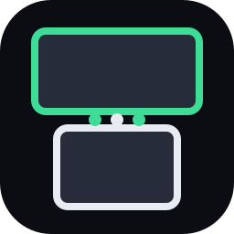

<p align="center"></p>

<h1 align="center">ScreenCTR</h1>
<p align="center"><b>Two screens. One connection.</b><br>Heivoli Network</p>

ScreenCTR diffuse en temps réel les deux écrans d'une New Nintendo 3DS / New 2DS XL vers
un PC Windows, sans câble ni carte de capture, et permet de jouer sur la vraie console avec
une manette branchée au PC.

> **État : version 0.1.0 en développement, pas encore validée sur console.**
> Le protocole, l'encodeur, la logique PC et la chaîne complète sont testés avec une fausse
> console ; le sysmodule et l'application Windows sont écrits mais pas encore compilés.
> Détail exact : [`docs/STATUS.md`](docs/STATUS.md).

## Téléchargement
Version de développement, compilée automatiquement — **pas encore validée sur console**.

| | |
|---|---|
| **Windows** | [ScreenCTR-Windows.zip](https://github.com/Heivoli-dev/ScreenCTR/releases/download/nightly/ScreenCTR-Windows.zip) → décompresser → `ScreenCTR\ScreenCTR.exe` |
| **Console** | [ScreenCTR.cia](https://github.com/Heivoli-dev/ScreenCTR/releases/download/nightly/ScreenCTR.cia) + [ScreenCTR-Launcher.3dsx](https://github.com/Heivoli-dev/ScreenCTR/releases/download/nightly/ScreenCTR-Launcher.3dsx) (dans `sd:/3ds/`) |

Installation du `.cia` avec FBI : **Remote Install → Scan QR Code**


## Fonctionnement
```
 New 3DS (Luma3DS)                                     PC Windows
┌──────────────────────────────┐   UDP 6465 (JPEG)   ┌──────────────────────────┐
│ sysmodule ScreenCTR          │ ──────────────────▶ │ ScreenCTR.exe (Qt 6)     │
│  capture GSP + DMA (cœur 2)  │   TCP 6464 (session)│  réassemblage + décodage │
│  JPEG maison, écrans inchangés│ ◀────────────────▶ │  dispositions, PNG, MP4  │
│  menu L+R+START, autorisation│   UDP 6466 (commandes)│ manettes SDL3, clavier, │
│  relais → Rosalina :4950     │ ◀────────────────── │  souris → écran tactile  │
└──────────────────────────────┘                     └──────────────────────────┘
```

## Dépôt
| Dossier | Contenu |
|---|---|
| `console/` | Sysmodule 3DS (C, libctru), RSF, lanceur |
| `pc/` | Application Windows (C++17, Qt 6, SDL3) — `pc/core/` sans Qt, testé |
| `protocol/` | Spécification et implémentation du protocole, partagées |
| `common/` | Encodeur JPEG, formats de pixels 3DS, configuration — partagés |
| `tools/` | Fausse console Linux, générateurs de police et d'icônes |
| `tests/` | Tests unitaires, test de bout en bout, plan de test matériel |
| `assets/` | Logo et icônes |
| `docs/` | Faisabilité, état, compilation, installation |

## Démarrage rapide
- Tester sans console : `bash scripts/run_tests.sh`
- Compiler : [`docs/BUILD.md`](docs/BUILD.md) · Installer : [`docs/INSTALL.md`](docs/INSTALL.md)
- Valider sur console : [`docs/HARDWARE_TEST_PLAN.md`](docs/HARDWARE_TEST_PLAN.md)
- Protocole : [`protocol/PROTOCOL.md`](protocol/PROTOCOL.md) · Choix techniques : [`docs/FEASIBILITY.md`](docs/FEASIBILITY.md)

Licence GPL-3.0-or-later — voir [`LICENSE`](LICENSE) et [`CREDITS.md`](CREDITS.md).
